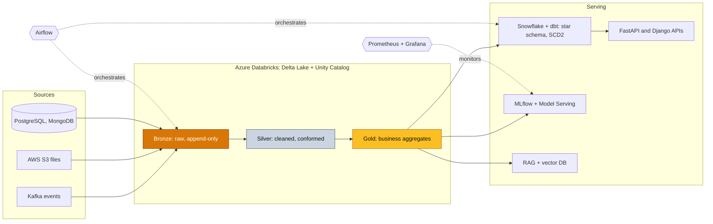

<!-- Header -->
<p align="center">
  
</p>

<p align="center">
  
</p>

<p align="center">
  <a href="https://www.linkedin.com/in/boumellassa-haythem"></a>
  <a href="mailto:Haythemboumellassa@hotmail.com"></a>
  
</p>

---

### About

I turn raw, messy operational data into platforms people can rely on: governed lakehouses, tested analytics models, low-latency APIs and ML services that stay healthy long after launch.

I trained as an applied mathematician (Engineering degree in Applied Mathematics, M2 in Data Science), and I build pipelines the way I was taught to write proofs: state the assumptions, test the invariants and leave nothing to hand-waving.

Today I'm a **Data Engineer & Backend Developer at Smart Conseil**, working with clients in Tunisia and Europe from first requirements to production. Before that I built insurance claims and fraud platforms at **VERMEG** and an ML sizing service at **Welyne Group**.

```yaml
engineer:
  name: Haythem Boumellassa
  now: Data Engineer & Backend Developer @ Smart Conseil (Jul 2025 → present)
  focus: [lakehouse, analytics engineering, streaming, backend APIs, ML in production]
  education:
    - Engineering degree, Applied Mathematics · ENSIT · 2025
    - M2 Data Science · ENSIT · 2025
  certifications: [DP-900, AI-900, AZ-900]
  languages: { arabic: native, french: professional, english: professional }
```

### Impact in numbers

<table>
  <tr>
    <td align="center" width="25%"><h3>50 GB/day</h3>ingested into a Databricks lakehouse, queryable in &lt; 10 min</td>
    <td align="center" width="25%"><h3>−70%</h3>data quality incidents with 80+ tested dbt models</td>
    <td align="center" width="25%"><h3>−35%</h3>AWS query cost through Parquet partitioning</td>
    <td align="center" width="25%"><h3>hours → 3 min</h3>multi-level KPI reporting, fully automated</td>
  </tr>
  <tr>
    <td align="center"><h3>p95 &lt; 150 ms</h3>ML inference on Databricks Model Serving</td>
    <td align="center"><h3>−65%</h3>API response time from SQL and caching work</td>
    <td align="center"><h3>92%</h3>fraud model accuracy, 30% fewer false positives</td>
    <td align="center"><h3>95%</h3>test coverage, with a passed compliance audit</td>
  </tr>
</table>

### What I do

**Data Engineering**
- Design **medallion lakehouses** on Azure Databricks (Delta Lake, Unity Catalog), ingesting from Kafka and AWS S3
- Model **Snowflake analytics layers in dbt**: data quality tests, SCD Type 2 snapshots and CI on every merge
- Run production **ETL/ELT** with Airflow and Celery over millions of records a day, with automated failure recovery
- Build **event-driven streaming** on Kafka and Redis Pub/Sub, which removed over 60% of processing bottlenecks

**Backend Engineering**
- Build **REST APIs and microservices** in FastAPI, Django REST Framework and Spring Boot, integrated with Odoo
- Design **multi-tenant data layers** with strict tenant isolation for a school management platform
- Secure and observe services with **Keycloak RBAC, Prometheus and Grafana**, shipped through GitLab CI/CD, Docker and Kubernetes

**Data Science & Applied Mathematics**
- Take models to production with the **MLflow registry and Databricks Model Serving**, including drift monitoring and Grafana alerts
- Build **RAG pipelines** (embeddings, vector database, LangChain) on Delta tables, with **30%** better answer relevance
- Build **fraud detection ensembles** (XGBoost, Random Forest) served on AWS Lambda in under 200 ms, worth an estimated **EUR 200K/year**
- Model risk and claim costs with **Monte Carlo simulation, Markov Decision Processes and linear programming**, giving **15–20%** better operational efficiency

### Reference architecture

The shape of the platform I build and run day to day:



### Tech stack

<table>
  <tr>
    <td><b>Languages</b></td>
    <td>
      
      
      
      
      
    </td>
  </tr>
  <tr>
    <td><b>Data platforms</b></td>
    <td>
      
      
      
      
    </td>
  </tr>
  <tr>
    <td><b>Processing</b></td>
    <td>
      
      
      
      
      
    </td>
  </tr>
  <tr>
    <td><b>Cloud</b></td>
    <td>
      
      
    </td>
  </tr>
  <tr>
    <td><b>Storage</b></td>
    <td>
      
      
      
      
    </td>
  </tr>
  <tr>
    <td><b>Backend</b></td>
    <td>
      
      
      
      
    </td>
  </tr>
  <tr>
    <td><b>ML / AI</b></td>
    <td>
      
      
      
      
      
    </td>
  </tr>
  <tr>
    <td><b>DevOps</b></td>
    <td>
      
      
      
      
      
      
      
    </td>
  </tr>
</table>

### Experience

| When | Where | Role | Highlights |
|---|---|---|---|
| Jul 2025 → now | **Smart Conseil**, Tunis | Data Engineer & Backend Developer | Databricks lakehouse, Snowflake + dbt, Kafka streaming, AWS, ML serving, RAG |
| Feb – Jun 2025 | **VERMEG**, Tunis | Data Engineer intern (final-year project) | Insurance claims microservices, Airflow pipelines on 500K+ records, fraud ML, MLOps |
| Jun – Aug 2024 | **Welyne Group** | Backend & Data intern | Size prediction API (FastAPI, scikit-learn), < 200 ms latency, 99% uptime |

### Selected work

| Project | Stack | What it shows |
|---|---|---|
| [**Insurance claims platform**](https://github.com/Beru47/Syst-me-de-gestion-des-sinistres-pour-assurances-non-vie-VERMEG-) · VERMEG | Spring Boot · Kafka · Kubernetes · Elasticsearch · Keycloak | Event-driven microservices for non-life claims: declaration, tracking, indemnification and fraud detection |
| [**Size prediction API**](https://github.com/Beru47/APi-internship-wefizz) · Welyne | FastAPI · scikit-learn · PostgreSQL · Redis | ML service predicting garment size from body measurements: **+25%** sizing accuracy, **−18%** returns |

### How I build

- **Idempotent first, fast second.** Every pipeline can be re-run safely before anyone tunes it.
- **Tests live next to the data.** Contracts, dbt tests and quality checks ship with the model, not in a wiki.
- **File layout before cluster size.** Partitioning and pruning beat throwing compute at a problem.
- **Observable by default.** If it runs in production, it has metrics, alerts and an owner.
- **Requirements before code.** I challenge assumptions with stakeholders before turning them into designs and milestones.

### Education & certifications

- **M2 Data Science**, ENSIT · 2025
- **Engineering degree in Applied Mathematics**, ENSIT · 2025
- Microsoft certified: **DP-900** Azure Data Fundamentals · **AI-900** Azure AI Fundamentals · **AZ-900** Azure Fundamentals

<p align="center">
  
</p>
