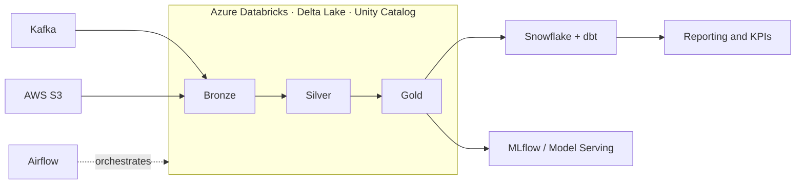

<h1 align="center">Haythem Boumellassa</h1>

<b>Data Engineer · Backend Developer</b> · Tunis, Tunisia

  
  
  

---

I build data platforms that the business can trust: lakehouses, analytics layers, batch and streaming pipelines, and the APIs and ML services that sit on top of them.

Currently **Data Engineer & Backend Developer at Smart Conseil**, previously VERMEG (insurance) and Welyne Group (e-commerce). Engineering degree in Applied Mathematics and M2 in Data Science (ENSIT).

## What I work on

- **Lakehouse on Azure Databricks**: Delta Lake, medallion architecture, Unity Catalog, ingesting **50 GB/day** from Kafka and S3, with reporting data available in **under 10 minutes**
- **Analytics engineering**: Snowflake + dbt, **80+ models**, data quality tests, SCD Type 2 snapshots, CI on every merge, giving **70% fewer data quality incidents**
- **Pipelines**: Airflow and Celery batch jobs processing millions of records a day with automated recovery, plus Kafka and Redis Pub/Sub streaming that removed **60%+** of processing bottlenecks
- **Cloud and cost**: AWS (S3, Glue, Athena, Lambda, IAM) with Docker and CI/CD; Parquet partitioning cut query cost by **35%**
- **ML in production**: MLflow registry with Databricks Model Serving (p95 **< 150 ms**), drift monitoring, and RAG over Delta tables

## Stack

| Area | Tools |
|---|---|
| Languages | Python, SQL, PySpark, Java, Bash |
| Platforms | Azure Databricks, Snowflake, dbt, Delta Lake |
| Processing | Spark, Airflow, Kafka, Celery, Polars |
| Cloud | AWS (S3, Glue, Athena, Lambda, IAM), Azure (Databricks, Data Factory) |
| Storage | PostgreSQL, MongoDB, Redis, Elasticsearch, vector databases |
| Modeling | Star schema, SCD Type 2, data quality testing |
| DevOps | Docker, Kubernetes, GitLab CI/CD, GitHub Actions, Prometheus, Grafana, Pytest |
| ML / AI | MLflow, scikit-learn, XGBoost, LangChain, RAG |
| Backend | FastAPI, Django REST Framework, Spring Boot, Keycloak |

## Selected work

| Project | What it shows |
|---|---|
| [Insurance claims platform (VERMEG)](https://github.com/Beru47/Syst-me-de-gestion-des-sinistres-pour-assurances-non-vie-VERMEG-) | Spring Boot microservices for non-life claims, event-driven on Kafka and Kubernetes, Elasticsearch, Keycloak, Prometheus/Grafana |
| [Size prediction API (Welyne)](https://github.com/Beru47/APi-internship-wefizz) | FastAPI + scikit-learn service predicting garment size, **25%** better sizing accuracy and **18%** fewer returns |

## How I work

- Pipelines are idempotent, tested and observable before they are fast
- Data contracts and quality tests live next to the models, not in a wiki
- Partitioning and file layout come before bigger clusters
- Requirements are worked out with stakeholders first, then turned into designs and milestones
